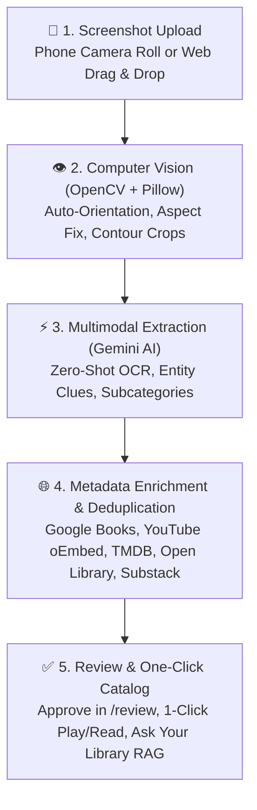

# 🧠 About MediaMind — The Intelligent Media & Knowledge Library

> **"Turn your screenshot graveyard into a verified, actionable personal library."**

---

## 🌟 The Vision & The Problem

Every single day, we discover incredible media while browsing:
* A book recommendation on an Instagram Reel
* A thought-provoking Substack essay on X / Twitter
* An in-depth coding tutorial or podcast episode on YouTube
* A documentary recommendation on Reddit
* A movie trailer on TikTok

Because saving links or typing notes breaks the flow of discovery, our natural reflex is simple: **take a screenshot**.

The inevitable result? **A massive "screenshot graveyard"** of hundreds of lost photos buried inside smartphone camera rolls:
* 📉 You forget why you captured the image.
* ❓ You can't remember the exact title or author.
* 🔗 You have no direct link to actually read, watch, or listen.
* 🔍 Finding anything requires endless manual scrolling through thousands of photos.

**MediaMind solves this permanently.**

By uniting **Computer Vision (OpenCV)**, **Multimodal AI (Google Gemini)**, and **Authoritative External APIs (Google Books, YouTube, TMDB, Substack)**, MediaMind transforms any screenshot into a permanent, verified library card with official cover art, topic tags, and a **1-click direct link** to read, watch, or listen immediately.

---

## ⚙️ How It Works (The 5-Step Intelligence Pipeline)



1. **Immutable Original Ingestion**: The raw screenshot is immediately fingerprinted with SHA-256 and stored in private cloud storage. Original assets are never overwritten or compressed away.
2. **Computer Vision Preprocessing**: OpenCV and Pillow correct smartphone EXIF orientation, normalize dimensions, and generate high-fidelity focused crops around the book cover, video thumbnail, or article snippet.
3. **Multimodal Document Intelligence**: Google Gemini performs zero-shot entity extraction, identifying titles, creators, content types, and normalized bounding boxes with structured Pydantic schema validation.
4. **Authoritative Resolution & Deduplication**: External adapters verify extracted entities against official databases while preventing duplicate records if multiple screenshots of the same item are uploaded.
5. **Interactive Personal Library & RAG**: A distraction-free personal library with 1-click "Open Link" buttons, topic tags (*Psychology*, *Money & Finance*, *Tech*, *Newsletters & Essays*), and the **"Ask Your Library" AI Assistant** to answer natural language questions in seconds.

---

## 📚 8 Supported Content Classes

MediaMind automatically recognizes, catalogs, and deep-links across:

| Media Type | Direct Link Destination | Example Subcategories |
| :--- | :--- | :--- |
| 📚 **Books** | Google Books / Amazon / Open Library | *Psychology*, *Habits*, *Money & Finance*, *Fiction*, *Self-Help*, *Philosophy* |
| ▶️ **YouTube Videos** | Direct YouTube Search & Video Deep Links | *Tech & Programming*, *Tutorials*, *Podcasts*, *Science*, *Education* |
| 📰 **Substack & Articles** | Substack Search & Canonical Article Links | *Tech & AI*, *Culture & Society*, *Finance & Markets*, *Essays*, *Startups* |
| ✉️ **Newsletters** | Direct Publication & Digest Links | *Weekly Dispatches*, *Author Digests*, *Industry Analysis* |
| 🎬 **Movies & Cinema** | IMDb Canonical Search & Detail Pages | *Sci-Fi*, *Drama*, *Thriller*, *Comedy*, *Action*, *Classics* |
| 📺 **TV Shows** | IMDb Series Pages & Episode Guides | *Drama*, *Comedy*, *Limited Series*, *Anime* |
| 🎓 **Online Courses** | Educational Platform & Topic Search | *Programming*, *Business*, *Design*, *AI & Data*, *Personal Growth* |
| 🎙️ **Podcasts** | Podcast Directories & Search | *Health & Sleep*, *Interviews*, *Technology*, *Business* |

---

## 🚀 Key User Features

### 1. Zero-Friction Upload Center (`/upload`)
- Single and bulk drag-and-drop screenshot uploads.
- Real-time background processing telemetry with sub-second polling.
- Independent job isolation: one failed screenshot never blocks the batch.

### 2. Human Review Center (`/review`)
- Side-by-side inspection of original screenshot evidence alongside AI-extracted metadata.
- Authoritative external match cards with calibrated confidence scores and explainability pills (e.g. `+ Exact title match`, `+ Creator verified`).
- 1-click "Approve & Add to Library" or instant inline metadata corrections.

### 3. Personal Study Library (`/library`)
- Clean, warm light-theme reading aesthetic designed for focus.
- **Scroll Wheel & Touch Navigation**: Category tabs feature smooth horizontal scrolling via mouse scroll wheel, cursor drag-and-drop, and mobile touch swiping with zero distracting scrollbars.
- Instant topic and subcategory filtering (*Habits*, *Programming*, *Finance*).
- 1-click direct link buttons to open content directly in YouTube, Google Books, IMDb, or Substack.

### 4. "Ask Your Library" AI Assistant (Enterprise RAG)
- Natural language Q&A over your personal library items and study notes.
- Grounded answers strictly in verified personal records with direct clickable citations.
- Sub-5-second execution SLA target.

---

## 🛠️ Technology Stack & Architecture

| Layer | Technologies | Purpose |
| :--- | :--- | :--- |
| **Frontend (`FE/`)** | Next.js 15 (App Router), TypeScript, Tailwind CSS, shadcn/ui, Lucide Icons | Responsive, mobile-first, distraction-free study aesthetic. |
| **Backend API (`BE/`)** | Python 3.12, FastAPI, Pydantic v2 | High-throughput async REST endpoints with automatic OpenAPI documentation. |
| **Worker Queue (`BE/`)** | Persistent Python worker runner, unified in `BE/run.py` | Concurrency-safe, idempotent background processing of uploaded screenshots. |
| **Database & Auth** | Supabase PostgreSQL 15, Supabase Auth, Row Level Security (RLS) | Strictly tenant-isolated personal data storage with zero data cross-leakage. |
| **Vector Search (RAG)** | Supabase `pgvector`, Gemini Embeddings | Sub-second semantic search ("Ask Your Library"). |
| **Computer Vision** | OpenCV (`cv2`), Pillow (`PIL`) | EXIF transpose, aspect-ratio preservation, non-destructive cropping. |
| **Multimodal AI** | Google Gemini API | Structured JSON zero-shot OCR and entity extraction. |
| **Metadata Adapters** | Google Books API, YouTube oEmbed, Open Library, TMDB | Verified external canonical records with token-bucket rate limiting. |

---

## 🔒 Security, Privacy & Integrity

* **Zero-Secret Client Policy**: Vendor API keys and service secrets exist only in server-side environment variables and are never exposed to client browsers.
* **Row-Level Security (RLS)**: Enforced across all 11 database tables. No user can ever query, search, or view another user's private media library or notes.
* **Visual Provenance**: When an item is verified, MediaMind maintains a permanent link (`item_sources`) connecting the verified entry back to the original screenshot crop.
* **Sub-5-Second SLA**: Ingestion, computer vision, AI extraction, and semantic search are engineered to execute in under 5 seconds end-to-end.

---

## 🚢 Deployment Architecture

MediaMind is production-ready and free-tier-first:
* **Frontend**: Deploy on **Vercel** with automatic edge CDN caching.
* **Backend API & Background Worker**: Deploy via Docker or native Python runner on **Render**, **Railway**, or **Fly.io**.
* **Database & Storage**: Managed on **Supabase** (PostgreSQL + Auth + Storage).

```bash
# Run complete stack locally:
python BE/run.py --frontend
```

---

## 👥 Authors & License

Developed with passion for lifelong learners, avid readers, and digital curators.  
Released under the **MIT License**.
