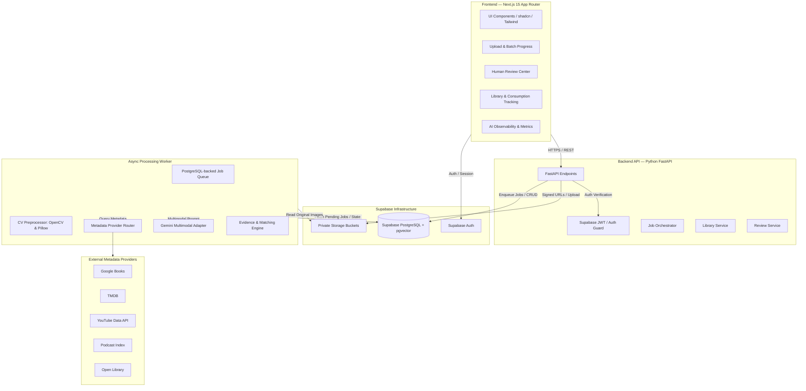

# MediaMind Architecture Specification

## 1. System Overview

MediaMind is an AI-powered personal media library engineered to convert screenshots of books, movies, TV shows, YouTube videos, documentaries, podcasts, and online courses into verified, enriched library entries.

The system is structured as a **modular monolith** with clear architectural boundaries, optimized for low-cost/free-tier deployment (Next.js on Vercel, Supabase for PostgreSQL/Auth/Storage, containerized Python FastAPI backend and worker) with robust local development fallbacks.

---

## 2. Five Core Engineering Disciplines

### 1. Multimodal Document Intelligence
- Analyzes uploaded screenshots directly with Gemini Multimodal models.
- Employs strict Pydantic schemas to validate structured candidate output: titles, creators, content types, years, release platforms, confidence scores, and visual evidence coordinates.
- Retains visual evidence quotes and region associations to distinguish visible on-screen text from model inferences.

### 2. Computer Vision (CV)
- Uses **Pillow** and **OpenCV** for non-destructive image validation, dimension analysis, SHA-256 calculation, and aspect ratio normalization.
- Detects multiple visual bounding boxes (e.g., side-by-side book covers, video lists, multi-item grids) without overwriting original assets.
- Stores coordinates $(x, y, w, h)$ relative to original dimensions. Generates derivative crops for inspection while preserving the original immutable screenshot.

### 3. LLM Evaluation & Observability
- Employs prompt versioning (e.g., `gemini-extract-v1.0.0`) and logs model identifiers, token consumption, latency, and estimated cost.
- Measures precision, recall, human-review rate, false-match rate, and auto-acceptance rate against a curated ground-truth test dataset.
- Completely separates evaluation metrics and benchmark runs from user operational data.

### 4. AI Workflow Automation
- Decouples file upload from processing using an asynchronous, PostgreSQL-backed stateful job queue (`processing_jobs`).
- Job states: `queued` $\rightarrow$ `processing` $\rightarrow$ `identified` | `needs_review` | `unidentified` | `failed`.
- Guarantees per-item isolation: failure of one screenshot in a bulk upload does not fail other items in the batch.
- Automatic exponential backoff retries with max retry caps; worker safe crash recovery.

### 5. Enterprise RAG Engine
- Embeds verified library records, canonical metadata, and user notes into `item_embeddings` using PostgreSQL `pgvector`.
- Strictly enforces tenant/user-ownership filters (`user_id = current_user`) before similarity search.
- Grounds answers strictly in retrieved personal records with direct citations and links to library items.

---

## 3. Modular Monolith Architecture

The codebase is organized into independent logical layers within a single repository:

- **`frontend/`**: Next.js App Router, TypeScript, Tailwind CSS, shadcn/ui. Handles user interactions, optimistic upload status, media playback previews, review workflows, and library visualization.
- **`backend/app/api/`**: FastAPI routers grouped by resource (`auth`, `assets`, `jobs`, `library`, `reviews`, `analytics`, `rag`).
- **`backend/app/core/`**: Configuration (`config.py`), security (`security.py`), exceptions, and logging.
- **`backend/app/db/`**: Database session management, base models, migrations, and repository patterns.
- **`backend/app/models/`**: SQLAlchemy models mirroring versioned SQL migrations.
- **`backend/app/schemas/`**: Pydantic schemas for request validation, API responses, and AI output validation.
- **`backend/app/services/`**: Business logic (LibraryService, AssetService, ReviewService, JobService, RAGService).
- **`backend/app/adapters/`**:
  - `ai/`: Gemini adapter with prompt versioning and fallback handlers.
  - `metadata/`: Metadata provider adapters (Google Books, TMDB, Open Library, YouTube, etc.) behind a unified `BaseMetadataAdapter` interface.
  - `storage/`: Supabase Storage adapter with local filesystem fallback for development.
- **`backend/app/worker/`**: Background processor loop for asynchronous job handling.
- **`migrations/`**: Chronological, reproducible, versioned SQL migration scripts.

---

## 4. Screenshot Processing Lifecycle

1. **Ingest & Validate**: Frontend uploads file to backend (or directly via signed upload URL). Backend validates MIME type (magic bytes check) and file size ($\le 15\text{MB}$).
2. **Hash & Store**: Computes SHA-256 hash. Uploads original image into private Supabase Storage bucket (`screenshots/{user_id}/{asset_id}.ext`).
3. **Persist Source Record**: Inserts record into `source_assets` with immutable storage reference and user ownership.
4. **Enqueue Job**: Inserts a new job into `processing_jobs` with status `queued`.
5. **Preprocessing & Region Proposal**: CV module checks resolution, contrast, and candidate regions/crops.
6. **Multimodal Extraction**: Gemini analyzes image with structured JSON output enforcing extracted entities and evidence.
7. **Metadata Query & Normalization**: Relevant provider adapters query external APIs using extracted titles/creators.
8. **Entity Resolution & Matching**: Heuristic scoring engine compares Gemini candidate against provider metadata (title similarity, creator match, year delta).
9. **Confidence Classification**:
   - Match score $\ge 0.85$ and high provider agreement $\rightarrow$ `identified` (auto-accepted or pending library confirmation).
   - $0.50 \le$ score $< 0.85$ or ambiguous candidates $\rightarrow$ `needs_review`.
   - Score $< 0.50$ or no provider candidates $\rightarrow$ `unidentified`.
10. **Persistence & Linkage**: Writes to `identification_candidates` and links to `library_items` via `item_sources`.
11. **Telemetry**: Logs prompt version, model, token counts, duration, and match decisions for observability.
