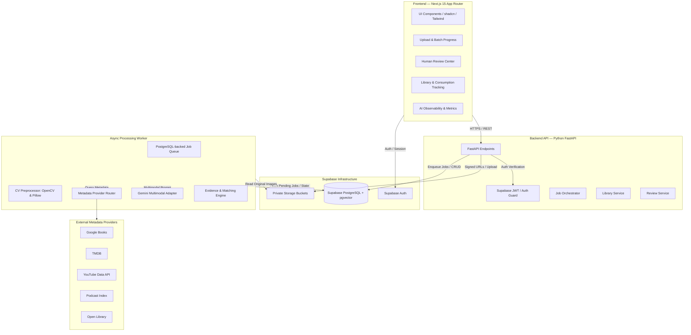

# MediaMind Architecture Specification

## 1. System Overview

MediaMind is an AI-powered personal media library engineered to convert screenshots of books, movies, TV shows, YouTube videos, documentaries, podcasts, and online courses into verified, enriched library entries.

The system is structured as a **modular monolith** with clear architectural boundaries, optimized for low-cost/free-tier deployment (Next.js on Vercel, Supabase for PostgreSQL/Auth/Storage, containerized Python FastAPI backend and worker) with robust local development fallbacks.

---

## 2. Five Core Engineering Disciplines

### 1. Multimodal Document Intelligence
- Analyzes uploaded screenshots directly with Gemini Multimodal models.
- Employs strict Pydantic schemas to validate structured candidate output: titles, creators, content types, years, release platforms, confidence scores, and visual evidence coordinates.
- Retains visual evidence quotes and region associations to distinguish visible on-screen text from model inferences.

### 2. Computer Vision (CV)
- Uses **Pillow** and **OpenCV** for non-destructive image validation, dimension analysis, SHA-256 calculation, and aspect ratio normalization.
- Detects multiple visual bounding boxes (e.g., side-by-side book covers, video lists, multi-item grids) without overwriting original assets.
- Stores coordinates $(x, y, w, h)$ relative to original dimensions. Generates derivative crops for inspection while preserving the original immutable screenshot.

### 3. LLM Evaluation & Observability
- Employs prompt versioning (e.g., `gemini-extract-v1.0.0`) and logs model identifiers, token consumption, latency, and estimated cost.
- Measures precision, recall, human-review rate, false-match rate, and auto-acceptance rate against a curated ground-truth test dataset.
- Completely separates evaluation metrics and benchmark runs from user operational data.

### 4. AI Workflow Automation
- Decouples file upload from processing using an asynchronous, PostgreSQL-backed stateful job queue (`processing_jobs`).
- Job states: `queued` $\rightarrow$ `processing` $\rightarrow$ `identified` | `needs_review` | `unidentified` | `failed`.
- Guarantees per-item isolation: failure of one screenshot in a bulk upload does not fail other items in the batch.
- Automatic exponential backoff retries with max retry caps; worker safe crash recovery.

### 5. Enterprise RAG Engine
- Embeds verified library records, canonical metadata, and user notes into `item_embeddings` using PostgreSQL `pgvector`.
- Strictly enforces tenant/user-ownership filters (`user_id = current_user`) before similarity search.
- Grounds answers strictly in retrieved personal records with direct citations and links to library items.

---

## 3. Modular Monolith Architecture

The codebase is organized into independent logical layers within a single repository:

- **`FE/`**: Next.js App Router, TypeScript, Tailwind CSS, shadcn/ui. Handles user interactions, optimistic upload status, media playback previews, review workflows, and library visualization.
- **`BE/app/api/`**: FastAPI routers grouped by resource (`auth`, `assets`, `jobs`, `library`, `reviews`, `analytics`, `rag`).
- **`BE/app/core/`**: Configuration (`config.py`), security (`security.py`), exceptions, and logging.
- **`BE/app/db/`**: Database session management, base models, migrations, and repository patterns.
- **`BE/app/models/`**: SQLAlchemy models mirroring versioned SQL migrations.
- **`BE/app/schemas/`**: Pydantic schemas for request validation, API responses, and AI output validation.
- **`BE/app/services/`**: Business logic (LibraryService, AssetService, ReviewService, JobService, RAGService).
- **`BE/app/adapters/`**:
  - `ai/`: Gemini adapter (`GeminiAdapter`) with structured JSON schema outputs, token/cost estimation, exponential retry, and versioned prompts (`v1.0.0`).
  - `metadata/`: Metadata provider adapters (Google Books, TMDB, Open Library, YouTube, etc.) behind a unified `BaseMetadataAdapter` interface.
  - `storage/`: Supabase Storage adapter with local filesystem fallback (`LocalStorageAdapter`) for development.
- **`BE/app/services/`**:
  - `cv_service.py`: Dedicated Computer Vision service for EXIF orientation correction, aspect-ratio-preserving resizing, NMS contour region proposals, and high-fidelity derivative crop generation.
- **`BE/app/worker/`**:
  - `runner.py`: Persistent, standalone background worker with atomic job claiming (`claim_next_job`), crash recovery (`recover_stale_jobs`), signal handling (SIGINT/SIGTERM), and tenant isolation.
- **`BE/run.py`**: Unified single-command development runner that concurrently starts the FastAPI API server and background worker.
- **`BE/app/eval/`**:
  - `dataset.json` & `runner.py`: Benchmark dataset and evaluation runner measuring precision, recall, F1, IoU, and latency.
- **`migrations/`**: Chronological, reproducible, versioned SQL migration scripts (001 through 007) supporting PostgreSQL 15+, Supabase, and SQLite.

---

## 4. Screenshot Processing Lifecycle (Milestones M1–M8)

1. **Ingest & Validate**: Frontend uploads file to backend. Backend validates image magic bytes and file size ($\le 15\text{MB}$).
2. **Hash & Store**: Computes SHA-256 hash. Uploads original image into private storage (`screenshots/{user_id}/{asset_id}.ext`). The original is immutable and never overwritten.
3. **Persist Source Record**: Inserts record into `source_assets` with immutable storage reference and user ownership.
4. **Enqueue Job**: Inserts a new job into `processing_jobs` with status `queued`.
5. **Background Claim**: Standalone background worker (`python -m app.worker.runner` or `python BE/run.py`) atomically claims the queued job, setting `status = 'processing'` and acquiring a time-bounded lease.
6. **Orientation & Preprocessing**: `CVService` applies EXIF orientation transpose, normalizes color space to RGB, and resizes to $\le 1600\text{px}$ maximum side length.
7. **Multimodal Extraction**: `GeminiAdapter` executes structured extraction with versioned prompt `v1.0.0`, extracting titles, creators, content types, visual clues, and normalized bounding boxes $[0, 1000]$.
8. **Telemetry Recording**: Inserts `processing_runs` record capturing prompt version, model name, prompt tokens, candidate tokens, total cost estimate, and latency.
9. **Derivative Crop Generation**: For each detected item with a valid bounding box, `CVService` generates a non-destructive crop from the oriented original, stores it under `screenshots/{user_id}/derivatives/{id}.jpg`, and registers `image_derivatives`.
10. **Candidate Persistence**: Inserts `identification_candidates` in `needs_review` review state with links to derivative crops and source screenshots.
11. **Human Review Queue**: User inspects candidates at `/review` with side-by-side crop/original previews, edits metadata as needed, and clicks "Approve & Add to Library" or "Reject".
12. **Library Linkage & Resolution**: Approving creates verified `LibraryItem`, creates an immutable `ItemSource` link connecting the original screenshot, marks the candidate `accepted`, and resolves the parent job to `identified`.

---

## 5. Security Architecture & Threat Model

### 5.1. Credential Security & Zero-Secret Policy
- All secrets (`GEMINI_API_KEY`, `SUPABASE_SERVICE_ROLE_KEY`, `DATABASE_URL`, `SUPABASE_JWT_SECRET`) are strictly maintained in local `.env` and `.env.local` files that are untracked by Git.
- Placeholder templates (`.env.example`, `BE/.env.example`) provide documentation without exposing production or development secrets.
- Automated tests and pre-commit checks verify that no secret strings, API keys, or connection credentials exist in repository files or Git history.

### 5.2. Credential Rotation Procedure
If a credential must be rotated due to suspected exposure or scheduled policy:
1. **Gemini API Key**:
   - Generate a new API key in Google AI Studio / Google Cloud Console.
   - Update `GEMINI_API_KEY` in `BE/.env` (and staging/production environment manager).
   - Restart backend API and worker processes (`python BE/run.py`).
   - Verify extraction with `pytest BE/tests/test_gemini_adapter.py`.
   - Delete/revoke the deprecated API key in Google Cloud Console.
2. **Supabase Database Connection / Service Role Key**:
   - Reset the database password or generate a new service role secret in the Supabase Dashboard (`Project Settings -> API` / `Database`).
   - Update `DATABASE_URL` and `SUPABASE_SERVICE_ROLE_KEY` in `BE/.env`.
   - Restart backend API and worker processes.
   - Run `python BE/scripts/test_live_supabase_postgresql_rls.py` to verify connectivity and RLS policy integrity.
3. **Supabase JWT Secret**:
   - Update `SUPABASE_JWT_SECRET` in `BE/.env`.
   - Verify JWT validation via `pytest BE/tests/test_audit_security_tenancy.py`.

### 5.3. Multi-Tenant Storage Protection & Path Traversal Guard
Local media serving (`/api/v1/assets/media/{file_path:path}`) employs five sequential defense-in-depth layers:
1. **Recursive URL Decoding**: Loops up to 5 iterations of `urllib.parse.unquote` to eliminate multi-layer URL encoding escapes (`%252e%252e%252f`).
2. **Canonical Subpath Sanitization**: Strips leading slashes, normalizes Windows and POSIX separators, and constructs canonical paths.
3. **Storage Boundary Containment**: Enforces `target_path.is_relative_to(user_storage_root)`. Any escape outside `screenshots/{user_id}` is rejected with `403 Forbidden`.
4. **Symlink Dereference Guard**: Resolves the strict canonical target on disk; if a symlink attempts to point outside `user_storage_root`, it is rejected with `403 Forbidden`.
5. **Database Ownership Verification**: Even within the user's directory, an arbitrary unindexed file cannot be served. The path must match a registered `SourceAsset` or `ImageDerivative` owned by the requesting `user_id`.

### 5.4. Worker Concurrency & Lease Token Architecture
To prevent split-brain worker executions in clustered environments:
1. **Atomic Claiming**: `claim_next_job` generates a unique `lease_token` (UUID v4) and performs an atomic SQL update where `status = 'queued' OR (status = 'processing' AND claimed_at < stale_cutoff)`.
2. **Lease Extension (Heartbeat)**: Workers periodically invoke `heartbeat_job(job_id, lease_token)`. If a worker's lease was reclaimed by another worker due to timeout, the heartbeat is rejected.
3. **Candidate Persistence Guard**: Before committing candidates or derivative crops, the worker queries `processing_jobs` filtering by `(id, status = 'processing', lease_token)`. If the lease was superseded, candidate insertion is aborted and rolled back.
4. **Atomic Job Completion**: Status transitions to `needs_review` or `unidentified` are guarded by `ProcessingJob.lease_token == lease_token`. A stale worker cannot overwrite the state of an actively reassigned job.
5. **Stale Job Recovery**: `recover_stale_jobs` resets abandoned jobs to `status = 'queued'`, increments `retry_count`, and clears `lease_token`, `claimed_by`, and `claimed_at`.
