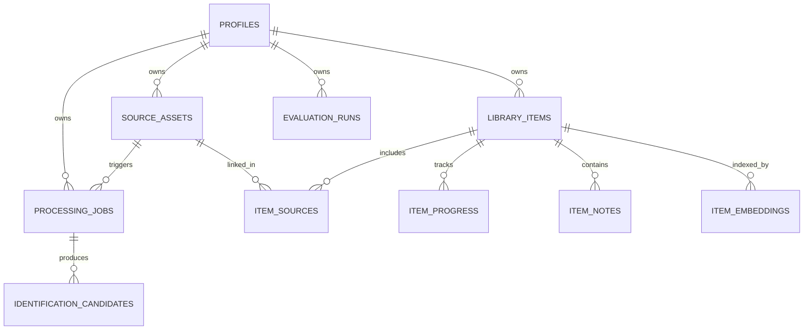

# MediaMind Database Architecture & Schema Specification

## 1. Design Principles

- **Engine**: Supabase PostgreSQL with `uuid-ossp` and `pgvector` extensions enabled.
- **Primary Keys**: UUID (`uuid_generate_v4()`) for all entity tables.
- **User Ownership**: Every user-owned entity contains a `user_id UUID NOT NULL REFERENCES auth.users(id) ON DELETE CASCADE`.
- **Row-Level Security (RLS)**: Enforced on all user-owned tables. No cross-tenant data leakage is permitted.
- **Immutability of Evidence**: `source_assets` and original screenshots are never deleted when extraction fails or user rejects matches.
- **Many-to-Many Linking**: A single screenshot may contain multiple library items; a single library item may have multiple supporting screenshot sources.

---

## 2. Entity-Relationship Overview



---

## 3. Core Tables Specification

### 3.1. `profiles`
Extends `auth.users` for application-specific preferences.
- `id` (UUID, PK, FK $\rightarrow$ `auth.users.id`)
- `display_name` (TEXT)
- `avatar_url` (TEXT)
- `preferences` (JSONB, default `{}`)
- `created_at` (TIMESTAMPTZ, default `NOW()`)
- `updated_at` (TIMESTAMPTZ, default `NOW()`)

### 3.2. `source_assets`
Represents the original, unmodified screenshot uploaded by the user.
- `id` (UUID, PK, default `gen_random_uuid()`)
- `user_id` (UUID, FK $\rightarrow$ `auth.users.id` ON DELETE CASCADE)
- `file_path` (TEXT NOT NULL) — Path inside Supabase private storage bucket (e.g. `screenshots/{user_id}/{asset_id}.png`)
- `file_name` (TEXT NOT NULL)
- `file_size_bytes` (BIGINT NOT NULL)
- `mime_type` (VARCHAR(100) NOT NULL)
- `sha256_hash` (VARCHAR(64) NOT NULL)
- `image_width` (INTEGER)
- `image_height` (INTEGER)
- `created_at` (TIMESTAMPTZ, default `NOW()`)
- *Indexes*: `(user_id, sha256_hash)` to quickly detect duplicate uploads per user.

### 3.3. `processing_jobs`
State machine for asynchronous screenshot processing.
- `id` (UUID, PK, default `gen_random_uuid()`)
- `user_id` (UUID, FK $\rightarrow$ `auth.users.id` ON DELETE CASCADE)
- `source_asset_id` (UUID, FK $\rightarrow$ `source_assets.id` ON DELETE CASCADE)
- `status` (VARCHAR(50) NOT NULL) — `queued`, `processing`, `identified`, `needs_review`, `unidentified`, `failed`
- `retry_count` (INTEGER DEFAULT 0)
- `max_retries` (INTEGER DEFAULT 3)
- `error_message` (TEXT)
- `ai_model_name` (VARCHAR(100))
- `prompt_version` (VARCHAR(50))
- `processing_time_ms` (INTEGER)
- `token_usage` (JSONB)
- `created_at` (TIMESTAMPTZ, default `NOW()`)
- `updated_at` (TIMESTAMPTZ, default `NOW()`)
- *Indexes*: `(user_id, status)`, `(status, created_at)` for queue polling.

### 3.4. `library_items`
Canonical records in user's personal media catalog.
- `id` (UUID, PK, default `gen_random_uuid()`)
- `user_id` (UUID, FK $\rightarrow$ `auth.users.id` ON DELETE CASCADE)
- `title` (TEXT NOT NULL)
- `creator` (TEXT) — Author, director, channel name, or instructor
- `content_type` (VARCHAR(50) NOT NULL) — `book`, `movie`, `tv_show`, `youtube_video`, `documentary`, `podcast`, `course`
- `consumption_status` (VARCHAR(50) NOT NULL DEFAULT 'want_to_consume') — `want_to_consume`, `consuming`, `completed`, `on_hold`, `dropped`
- `release_year` (INTEGER)
- `overview` (TEXT)
- `cover_image_url` (TEXT)
- `external_provider` (VARCHAR(50)) — e.g. `google_books`, `tmdb`, `youtube`, `open_library`
- `external_id` (TEXT)
- `provider_metadata` (JSONB DEFAULT '{}')
- `user_rating` (NUMERIC(3, 1)) — Scale 0.0 to 10.0 or 1 to 5
- `verification_status` (VARCHAR(50) NOT NULL DEFAULT 'verified') — `verified`, `manual_entry`, `auto_accepted`
- `created_at` (TIMESTAMPTZ, default `NOW()`)
- `updated_at` (TIMESTAMPTZ, default `NOW()`)
- *Indexes*: `(user_id, content_type)`, `(user_id, consumption_status)`, `(user_id, title)`.

### 3.5. `item_sources`
Many-to-many junction linking `library_items` to `source_assets`.
- `id` (UUID, PK, default `gen_random_uuid()`)
- `library_item_id` (UUID, FK $\rightarrow$ `library_items.id` ON DELETE CASCADE)
- `source_asset_id` (UUID, FK $\rightarrow$ `source_assets.id` ON DELETE CASCADE)
- `crop_coordinates` (JSONB) — `{"x": 100, "y": 200, "w": 400, "h": 600}` relative to original dimensions
- `detection_confidence` (NUMERIC(4, 3))
- `created_at` (TIMESTAMPTZ, default `NOW()`)
- *Constraints*: `UNIQUE(library_item_id, source_asset_id)`.

### 3.6. `identification_candidates`
Stores all potential matches proposed by AI and metadata adapters before resolution.
- `id` (UUID, PK, default `gen_random_uuid()`)
- `job_id` (UUID, FK $\rightarrow$ `processing_jobs.id` ON DELETE CASCADE)
- `source_asset_id` (UUID, FK $\rightarrow$ `source_assets.id` ON DELETE CASCADE)
- `user_id` (UUID, FK $\rightarrow$ `auth.users.id` ON DELETE CASCADE)
- `suggested_title` (TEXT NOT NULL)
- `suggested_creator` (TEXT)
- `suggested_type` (VARCHAR(50))
- `confidence_score` (NUMERIC(4, 3))
- `evidence_text` (TEXT) — Text visible in image that supports this match
- `bounding_box` (JSONB)
- `provider_candidates` (JSONB DEFAULT '[]') — Array of matches returned from TMDB, Google Books, etc.
- `resolution_status` (VARCHAR(50) DEFAULT 'pending') — `pending`, `accepted`, `rejected`, `dismissed`
- `resolved_library_item_id` (UUID, FK $\rightarrow$ `library_items.id` ON DELETE SET NULL)
- `created_at` (TIMESTAMPTZ, default `NOW()`)
- `resolved_at` (TIMESTAMPTZ)

### 3.7. `item_progress`
Tracks user consumption progression.
- `id` (UUID, PK, default `gen_random_uuid()`)
- `library_item_id` (UUID, FK $\rightarrow$ `library_items.id` ON DELETE CASCADE)
- `user_id` (UUID, FK $\rightarrow$ `auth.users.id` ON DELETE CASCADE)
- `current_progress` (NUMERIC(7, 2)) — e.g. page number, timestamp in seconds, episode index
- `total_progress` (NUMERIC(7, 2)) — e.g. total pages, video duration, total episodes
- `progress_unit` (VARCHAR(30)) — `pages`, `minutes`, `episodes`, `percentage`
- `updated_at` (TIMESTAMPTZ, default `NOW()`)

### 3.8. `item_notes`
User personal reviews, takeaways, and timestamps.
- `id` (UUID, PK, default `gen_random_uuid()`)
- `library_item_id` (UUID, FK $\rightarrow$ `library_items.id` ON DELETE CASCADE)
- `user_id` (UUID, FK $\rightarrow$ `auth.users.id` ON DELETE CASCADE)
- `content` (TEXT NOT NULL)
- `created_at` (TIMESTAMPTZ, default `NOW()`)
- `updated_at` (TIMESTAMPTZ, default `NOW()`)

### 3.9. `item_embeddings`
Stores vector embeddings for Enterprise RAG semantic search.
- `id` (UUID, PK, default `gen_random_uuid()`)
- `library_item_id` (UUID, FK $\rightarrow$ `library_items.id` ON DELETE CASCADE)
- `user_id` (UUID, FK $\rightarrow$ `auth.users.id` ON DELETE CASCADE)
- `embedding_source` (VARCHAR(50)) — `metadata`, `note`, `overview`
- `embedding` (VECTOR(768)) — 768-dim embeddings (e.g., text-embedding-004)
- `content_chunk` (TEXT NOT NULL)
- `created_at` (TIMESTAMPTZ, default `NOW()`)
- *Index*: `item_embeddings_vector_idx USING ivfflat (embedding vector_cosine_ops)`.

### 3.10. `evaluation_runs`
System benchmark and LLM evaluation runs.
- `id` (UUID, PK, default `gen_random_uuid()`)
- `benchmark_suite` (VARCHAR(100) NOT NULL)
- `model_name` (VARCHAR(100) NOT NULL)
- `prompt_version` (VARCHAR(50) NOT NULL)
- `dataset_size` (INTEGER NOT NULL)
- `precision_score` (NUMERIC(5, 4))
- `recall_score` (NUMERIC(5, 4))
- `review_rate` (NUMERIC(5, 4))
- `avg_latency_ms` (INTEGER)
- `total_tokens` (INTEGER)
- `estimated_cost_usd` (NUMERIC(8, 4))
- `details` (JSONB)
- `created_at` (TIMESTAMPTZ, default `NOW()`)

---

## 4. Row Level Security (RLS) Policy Blueprint

Every table possessing `user_id` must enforce RLS:

```sql
ALTER TABLE source_assets ENABLE ROW LEVEL SECURITY;
CREATE POLICY "Users can only access their own source assets"
    ON source_assets
    FOR ALL
    USING (auth.uid() = user_id);

ALTER TABLE processing_jobs ENABLE ROW LEVEL SECURITY;
CREATE POLICY "Users can only access their own processing jobs"
    ON processing_jobs
    FOR ALL
    USING (auth.uid() = user_id);

ALTER TABLE library_items ENABLE ROW LEVEL SECURITY;
CREATE POLICY "Users can only access their own library items"
    ON library_items
    FOR ALL
    USING (auth.uid() = user_id);

ALTER TABLE identification_candidates ENABLE ROW LEVEL SECURITY;
CREATE POLICY "Users can only access their own identification candidates"
    ON identification_candidates
    FOR ALL
    USING (auth.uid() = user_id);

ALTER TABLE item_notes ENABLE ROW LEVEL SECURITY;
CREATE POLICY "Users can only access their own item notes"
    ON item_notes
    FOR ALL
    USING (auth.uid() = user_id);

ALTER TABLE item_embeddings ENABLE ROW LEVEL SECURITY;
CREATE POLICY "Users can only access their own embeddings"
    ON item_embeddings
    FOR ALL
    USING (auth.uid() = user_id);
```
