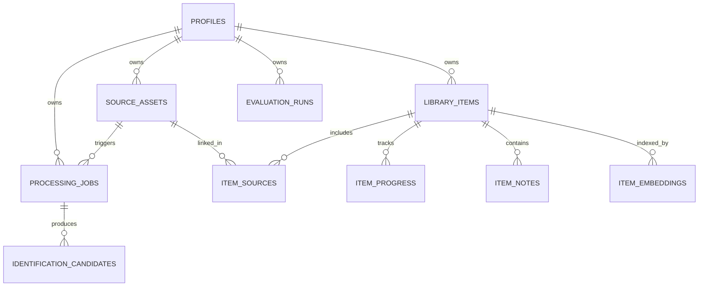

# MediaMind Database Architecture & Schema Specification

## 1. Design Principles

- **Engine**: Supabase PostgreSQL with `uuid-ossp` and `pgvector` extensions enabled.
- **Primary Keys**: UUID (`uuid_generate_v4()`) for all entity tables.
- **User Ownership**: Every user-owned entity contains a `user_id UUID NOT NULL REFERENCES auth.users(id) ON DELETE CASCADE`.
- **Row-Level Security (RLS)**: Enforced on all user-owned tables. No cross-tenant data leakage is permitted.
- **Immutability of Evidence**: `source_assets` and original screenshots are never deleted when extraction fails or user rejects matches.
- **Many-to-Many Linking**: A single screenshot may contain multiple library items; a single library item may have multiple supporting screenshot sources.

---

## 2. Entity-Relationship Overview



---

## 3. Core Tables Specification

### 3.1. `profiles`
Extends `auth.users` for application-specific preferences.
- `id` (UUID, PK, FK $\rightarrow$ `auth.users.id`)
- `display_name` (TEXT)
- `avatar_url` (TEXT)
- `preferences` (JSONB, default `{}`)
- `created_at` (TIMESTAMPTZ, default `NOW()`)
- `updated_at` (TIMESTAMPTZ, default `NOW()`)

### 3.2. `source_assets`
Represents the original, unmodified screenshot uploaded by the user.
- `id` (UUID, PK, default `gen_random_uuid()`)
- `user_id` (UUID, FK $\rightarrow$ `auth.users.id` ON DELETE CASCADE)
- `file_path` (TEXT NOT NULL) — Path inside Supabase private storage bucket (e.g. `screenshots/{user_id}/{asset_id}.png`)
- `file_name` (TEXT NOT NULL)
- `file_size_bytes` (BIGINT NOT NULL)
- `mime_type` (VARCHAR(100) NOT NULL)
- `sha256_hash` (VARCHAR(64) NOT NULL)
- `image_width` (INTEGER)
- `image_height` (INTEGER)
- `idempotency_key` (VARCHAR(255), optional) — Client idempotency key for network retry deduplication.
- `created_at` (TIMESTAMPTZ, default `NOW()`)
- *Indexes*:
  - `(user_id, sha256_hash)` to quickly detect duplicate uploads per user.
  - `(user_id, idempotency_key)` to deduplicate repeated client upload requests.

### 3.3. `processing_jobs`
State machine for asynchronous screenshot processing.
- `id` (UUID, PK, default `gen_random_uuid()`)
- `user_id` (UUID, FK $\rightarrow$ `auth.users.id` ON DELETE CASCADE)
- `source_asset_id` (UUID, FK $\rightarrow$ `source_assets.id` ON DELETE CASCADE)
- `status` (VARCHAR(50) NOT NULL) — `queued`, `processing`, `awaiting_identification`, `completed`, `identified`, `needs_review`, `unidentified`, `failed`
- `retry_count` (INTEGER DEFAULT 0)
- `max_retries` (INTEGER DEFAULT 3)
- `error_message` (TEXT)
- `claimed_at` (TIMESTAMPTZ) — Timestamp when a background worker atomically claimed this job.
- `claimed_by` (VARCHAR(100)) — Identifier of the worker holding the lock.
- `lease_token` (VARCHAR(36)) — Cryptographic UUID lease token assigned per claim to guarantee execution ownership.
- `ai_model_name` (VARCHAR(100))
- `prompt_version` (VARCHAR(50))
- `processing_time_ms` (INTEGER)
- `token_usage` (JSONB)
- `created_at` (TIMESTAMPTZ, default `NOW()`)
- `updated_at` (TIMESTAMPTZ, default `NOW()`)
- *Indexes*:
  - `(user_id, status)` for user job status queries.
  - `(status, created_at)` for queue polling.
  - `(status, claimed_at)` for safe concurrency claiming and stale job recovery.
  - `(id, lease_token)` for worker lease ownership and heartbeat verification.

### 3.4. `library_items`
Canonical records in user's personal media catalog.
- `id` (UUID, PK, default `gen_random_uuid()`)
- `user_id` (UUID, FK $\rightarrow$ `auth.users.id` ON DELETE CASCADE)
- `title` (TEXT NOT NULL)
- `creator` (TEXT) — Author, director, channel name, or instructor
- `content_type` (VARCHAR(50) NOT NULL) — `book`, `movie`, `tv_show`, `youtube_video`, `documentary`, `podcast`, `course`, `other`
- `subcategory` (VARCHAR(100)) — Topic or genre subcategory (e.g., `Psychology`, `Habits`, `Money & Finance`, `Sci-Fi`, `Business`)
- `direct_url` (TEXT) — Authoritative direct link or canonical search URL for immediate 1-click visit
- `consumption_status` (VARCHAR(50) NOT NULL DEFAULT 'want_to_consume') — `want_to_consume`, `consuming`, `completed`, `on_hold`, `dropped`
- `release_year` (INTEGER)
- `overview` (TEXT)
- `cover_image_url` (TEXT)
- `external_provider` (VARCHAR(50)) — e.g. `google_books`, `tmdb`, `youtube`, `open_library`
- `external_id` (TEXT)
- `provider_metadata` (JSONB DEFAULT '{}')
- `user_rating` (NUMERIC(3, 1)) — Scale 0.0 to 10.0 or 1 to 5
- `verification_status` (VARCHAR(50) NOT NULL DEFAULT 'verified') — `verified`, `manual_entry`, `auto_accepted`
- `created_at` (TIMESTAMPTZ, default `NOW()`)
- `updated_at` (TIMESTAMPTZ, default `NOW()`)
- *Indexes*: `(user_id, content_type)`, `(user_id, subcategory)`, `(user_id, consumption_status)`, `(user_id, title)`.

### 3.5. `item_sources`
Many-to-many junction linking `library_items` to `source_assets`.
- `id` (UUID, PK, default `gen_random_uuid()`)
- `library_item_id` (UUID, FK $\rightarrow$ `library_items.id` ON DELETE CASCADE)
- `source_asset_id` (UUID, FK $\rightarrow$ `source_assets.id` ON DELETE CASCADE)
- `crop_coordinates` (JSONB) — `{"x": 100, "y": 200, "w": 400, "h": 600}` relative to original dimensions
- `detection_confidence` (NUMERIC(4, 3))
- `created_at` (TIMESTAMPTZ, default `NOW()`)
- *Constraints*: `UNIQUE(library_item_id, source_asset_id)`.

### 3.6. `identification_candidates`
Stores all potential matches proposed by AI and metadata adapters before resolution.
- `id` (UUID, PK, default `gen_random_uuid()`)
- `job_id` (UUID, FK $\rightarrow$ `processing_jobs.id` ON DELETE CASCADE)
- `source_asset_id` (UUID, FK $\rightarrow$ `source_assets.id` ON DELETE CASCADE)
- `user_id` (UUID, FK $\rightarrow$ `auth.users.id` ON DELETE CASCADE)
- `suggested_title` (TEXT NOT NULL)
- `suggested_creator` (TEXT)
- `suggested_type` (VARCHAR(50))
- `suggested_subcategory` (VARCHAR(100))
- `direct_url` (TEXT)
- `confidence_score` (NUMERIC(4, 3))
- `evidence_text` (TEXT) — Text visible in image that supports this match
- `bounding_box` (JSONB)
- `provider_candidates` (JSONB DEFAULT '[]') — Array of matches returned from TMDB, Google Books, etc.
- `resolution_status` (VARCHAR(50) DEFAULT 'pending') — `pending`, `accepted`, `rejected`, `dismissed`
- `resolved_library_item_id` (UUID, FK $\rightarrow$ `library_items.id` ON DELETE SET NULL)
- `created_at` (TIMESTAMPTZ, default `NOW()`)
- `resolved_at` (TIMESTAMPTZ)

### 3.7. `item_progress`
Tracks user consumption progression.
- `id` (UUID, PK, default `gen_random_uuid()`)
- `library_item_id` (UUID, FK $\rightarrow$ `library_items.id` ON DELETE CASCADE)
- `user_id` (UUID, FK $\rightarrow$ `auth.users.id` ON DELETE CASCADE)
- `current_progress` (NUMERIC(7, 2)) — e.g. page number, timestamp in seconds, episode index
- `total_progress` (NUMERIC(7, 2)) — e.g. total pages, video duration, total episodes
- `progress_unit` (VARCHAR(30)) — `pages`, `minutes`, `episodes`, `percentage`
- `updated_at` (TIMESTAMPTZ, default `NOW()`)

### 3.8. `item_notes`
User personal reviews, takeaways, and timestamps.
- `id` (UUID, PK, default `gen_random_uuid()`)
- `library_item_id` (UUID, FK $\rightarrow$ `library_items.id` ON DELETE CASCADE)
- `user_id` (UUID, FK $\rightarrow$ `auth.users.id` ON DELETE CASCADE)
- `content` (TEXT NOT NULL)
- `created_at` (TIMESTAMPTZ, default `NOW()`)
- `updated_at` (TIMESTAMPTZ, default `NOW()`)

### 3.9. `item_embeddings`
Stores vector embeddings for Enterprise RAG semantic search.
- `id` (UUID, PK, default `gen_random_uuid()`)
- `library_item_id` (UUID, FK $\rightarrow$ `library_items.id` ON DELETE CASCADE)
- `user_id` (UUID, FK $\rightarrow$ `auth.users.id` ON DELETE CASCADE)
- `embedding_source` (VARCHAR(50)) — `metadata`, `note`, `overview`
- `embedding` (VECTOR(768)) — 768-dim embeddings (e.g., text-embedding-004)
- `content_chunk` (TEXT NOT NULL)
- `created_at` (TIMESTAMPTZ, default `NOW()`)
- *Index*: `item_embeddings_vector_idx USING ivfflat (embedding vector_cosine_ops)`.

### 3.10. `evaluation_runs`
System benchmark and LLM evaluation runs.
- `id` (UUID, PK, default `gen_random_uuid()`)
- `benchmark_suite` (VARCHAR(100) NOT NULL)
- `model_name` (VARCHAR(100) NOT NULL)
- `prompt_version` (VARCHAR(50) NOT NULL)
- `dataset_size` (INTEGER NOT NULL)
- `precision_score` (NUMERIC(5, 4))
- `recall_score` (NUMERIC(5, 4))
- `review_rate` (NUMERIC(5, 4))
- `avg_latency_ms` (INTEGER)
- `total_tokens` (INTEGER)
- `estimated_cost_usd` (NUMERIC(8, 4))
- `details` (JSONB)
- `created_at` (TIMESTAMPTZ, default `NOW()`)

---

## 4. Row Level Security (RLS) Policy Blueprint

Every table possessing `user_id` must enforce RLS:

```sql
ALTER TABLE source_assets ENABLE ROW LEVEL SECURITY;
CREATE POLICY "Users can only access their own source assets"
    ON source_assets
    FOR ALL
    USING (auth.uid() = user_id);

ALTER TABLE processing_jobs ENABLE ROW LEVEL SECURITY;
CREATE POLICY "Users can only access their own processing jobs"
    ON processing_jobs
    FOR ALL
    USING (auth.uid() = user_id);

ALTER TABLE library_items ENABLE ROW LEVEL SECURITY;
CREATE POLICY "Users can only access their own library items"
    ON library_items
    FOR ALL
    USING (auth.uid() = user_id);

ALTER TABLE identification_candidates ENABLE ROW LEVEL SECURITY;
CREATE POLICY "Users can only access their own identification candidates"
    ON identification_candidates
    FOR ALL
    USING (auth.uid() = user_id);

ALTER TABLE item_notes ENABLE ROW LEVEL SECURITY;
CREATE POLICY "Users can only access their own item notes"
    ON item_notes
    FOR ALL
    USING (auth.uid() = user_id);

ALTER TABLE item_embeddings ENABLE ROW LEVEL SECURITY;
CREATE POLICY "Users can only access their own embeddings"
    ON item_embeddings
    FOR ALL
    USING (auth.uid() = user_id);
```

---

## 5. Milestone M3 Schema Migration (`003_m3_extraction_and_derivatives.sql`)

Migration 003 introduces dedicated telemetry and derivative asset storage for multimodal AI extraction and computer vision processing.

### 5.1 New Tables

#### `processing_runs`
Records per-execution telemetry, token accounting, and latency for AI extractions:

| Column | Type | Constraints / Description |
|---|---|---|
| `id` | `UUID` | Primary Key, default `gen_random_uuid()` |
| `job_id` | `UUID` | Foreign Key $\rightarrow$ `processing_jobs.id` (ON DELETE CASCADE) |
| `user_id` | `UUID` | Foreign Key $\rightarrow$ `auth.users(id)` (ON DELETE CASCADE), Indexed |
| `source_asset_id` | `UUID` | Foreign Key $\rightarrow$ `source_assets.id` (ON DELETE CASCADE), Indexed |
| `prompt_identifier` | `VARCHAR(100)` | Prompt task identifier (e.g. `gemini_multimodal_extraction`) |
| `prompt_version` | `VARCHAR(50)` | Version of prompt used (e.g. `v1.0.0`) |
| `ai_model_name` | `VARCHAR(100)` | Runtime model identifier (e.g. `gemini-2.5-flash`) |
| `status` | `VARCHAR(50)` | Status: `completed`, `failed` |
| `processing_duration_ms`| `INTEGER` | Total end-to-end model and processing latency |
| `prompt_tokens` | `INTEGER` | Input token count |
| `candidate_tokens` | `INTEGER` | Generated output token count |
| `total_tokens` | `INTEGER` | Total tokens consumed |
| `estimated_cost_usd` | `NUMERIC(8,6)`| Estimated dollar cost based on model pricing |
| `region_count` | `INTEGER` | Number of CV candidate regions detected |
| `candidate_count` | `INTEGER` | Number of candidate items extracted |
| `error_category` | `VARCHAR(100)` | Failure classification (e.g. `rate_limit`, `api_error`, `schema_error`) |
| `error_message` | `TEXT` | Sanitized error details |
| `raw_response` | `JSONB` | Auditable raw JSON response |
| `created_at` | `TIMESTAMPTZ` | Timestamp of run |

#### `image_derivatives`
Stores non-destructive visual artifacts (bounding-box crops, resized derivatives):

| Column | Type | Constraints / Description |
|---|---|---|
| `id` | `UUID` | Primary Key, default `gen_random_uuid()` |
| `user_id` | `UUID` | Foreign Key $\rightarrow$ `auth.users(id)` (ON DELETE CASCADE), Indexed |
| `source_asset_id` | `UUID` | Foreign Key $\rightarrow$ `source_assets.id` (ON DELETE CASCADE), Indexed |
| `run_id` | `UUID` | Foreign Key $\rightarrow$ `processing_runs.id` (ON DELETE CASCADE) |
| `derivative_type` | `VARCHAR(50)` | Type: `crop`, `region_crop`, `preprocessed`, `thumbnail` |
| `storage_path` | `TEXT` | Private storage path (`screenshots/{user_id}/derivatives/{id}.jpg`) |
| `file_name` | `TEXT` | File name |
| `file_size_bytes` | `BIGINT` | File size in bytes |
| `mime_type` | `VARCHAR(100)` | MIME type (`image/jpeg`) |
| `image_width` | `INTEGER` | Width in pixels |
| `image_height` | `INTEGER` | Height in pixels |
| `bounding_box` | `JSONB` | Normalized coordinates `{"x_min", "y_min", "x_max", "y_max"}` |
| `processing_version` | `VARCHAR(50)`| Processing version tag |
| `created_at` | `TIMESTAMPTZ` | Creation timestamp |

### 5.2 Extended `identification_candidates`
Extended with multimodal extraction clues and resolution status:
- `run_id`: Links candidate to specific `processing_runs` execution.
- `derivative_id`: Links candidate to visual crop in `image_derivatives`.
- `additional_creators`: JSON list of supporting authors, hosts, or contributors.
- `description_clue`: Brief extracted synopsis.
- `year_clue`: Release year detected in visible text.
- `visible_text`: Verbatim text snippets detected on screen.
- `identifying_clues`: Visual badges, logos, or platform indicators.
- `uncertainty_reasons`: Structured reasons why candidate may require human review.
- `resolution_status`: `pending` $\rightarrow$ `resolved`.
- `resolved_library_item_id`: Foreign key to `library_items.id` created upon acceptance.
- `resolved_at`: Resolution timestamp.

### 5.3 Complete Row-Level Security Matrix (All 11 User Tables)
Row-Level Security (RLS) is strictly enforced on all 11 user-owned tables restricting `SELECT`, `INSERT`, `UPDATE`, and `DELETE` operations to the authenticated user context (`auth.uid()`):

| Table | Policy Name | Enforcement Mechanism |
|---|---|---|
| `profiles` | "Users can manage own profile" | `auth.uid() = id` |
| `source_assets` | "Users can manage own source assets" | `auth.uid() = user_id` |
| `processing_jobs` | "Users can manage own processing jobs" | `auth.uid() = user_id` |
| `processing_runs` | "Users can manage own processing runs" | `auth.uid() = user_id` |
| `image_derivatives` | "Users can manage own image derivatives" | `auth.uid() = user_id` |
| `identification_candidates` | "Users can manage own identification candidates" | `auth.uid() = user_id` |
| `library_items` | "Users can manage own library items" | `auth.uid() = user_id` |
| `item_sources` | "Users can access own item sources" | `EXISTS(library_items.user_id = auth.uid()) AND EXISTS(source_assets.user_id = auth.uid())` |
| `item_notes` | "Users can manage own item notes" | `auth.uid() = user_id` |
| `item_progress` | "Users can manage own item progress" | `auth.uid() = user_id` |
| `item_embeddings` | "Users can manage own item embeddings" | `auth.uid() = user_id` |

#### `evaluation_runs` Audit
`evaluation_runs` contains offline AI benchmark executions (`benchmark_suite`, `model_name`, `precision_score`, `recall_score`, `total_tokens`). It has **no** `user_id` foreign key and stores zero user-private assets or PII. It is maintained as a global observability table where writes are restricted to trusted backend jobs/service roles, and reads are permitted for system metrics dashboards.

---

## 6. Migration 004: Worker Lease Token (`004_worker_lease_token.sql`)
Implemented to eliminate race conditions and split-brain execution across distributed workers:
```sql
ALTER TABLE processing_jobs ADD COLUMN IF NOT EXISTS lease_token VARCHAR(36);
CREATE INDEX IF NOT EXISTS idx_processing_jobs_lease ON processing_jobs(id, lease_token);
```
- Adds unique per-claim UUID `lease_token`.
- Verified live on Supabase PostgreSQL.

---

## 7. Migration 005: Topic Subcategories & Direct URLs (`005_add_subcategory_and_direct_url.sql`)
Adds canonical topic classification and clickable destinations for media entries:
```sql
ALTER TABLE library_items ADD COLUMN IF NOT EXISTS subcategory VARCHAR(100);
ALTER TABLE library_items ADD COLUMN IF NOT EXISTS direct_url TEXT;
CREATE INDEX IF NOT EXISTS idx_library_items_user_subcategory ON library_items(user_id, subcategory);

ALTER TABLE identification_candidates ADD COLUMN IF NOT EXISTS suggested_subcategory VARCHAR(100);
ALTER TABLE identification_candidates ADD COLUMN IF NOT EXISTS direct_url TEXT;
CREATE INDEX IF NOT EXISTS idx_identification_candidates_subcategory ON identification_candidates(user_id, suggested_subcategory);
```

---

## 8. Migration 006: Extended Metadata & Deduplication (`006_m4_metadata_and_deduplication.sql`)
Adds external metadata attributes and unique constraints for M4 metadata resolution:
```sql
ALTER TABLE library_items ADD COLUMN IF NOT EXISTS original_title TEXT;
ALTER TABLE library_items ADD COLUMN IF NOT EXISTS isbn VARCHAR(20);
ALTER TABLE library_items ADD COLUMN IF NOT EXISTS genre VARCHAR(100);
ALTER TABLE library_items ADD COLUMN IF NOT EXISTS runtime_minutes INTEGER;
ALTER TABLE library_items ADD COLUMN IF NOT EXISTS language VARCHAR(10);
ALTER TABLE library_items ADD COLUMN IF NOT EXISTS publisher VARCHAR(200);
ALTER TABLE library_items ADD COLUMN IF NOT EXISTS total_seasons INTEGER;
ALTER TABLE library_items ADD COLUMN IF NOT EXISTS total_episodes INTEGER;
ALTER TABLE library_items ADD COLUMN IF NOT EXISTS last_synced_at TIMESTAMPTZ DEFAULT NOW();

CREATE UNIQUE INDEX IF NOT EXISTS uq_library_items_user_provider_ext_id
    ON library_items(user_id, external_provider, external_id)
    WHERE external_provider IS NOT NULL AND external_id IS NOT NULL;
```

---

## 9. Migration 007: Substack, Articles & Newsletters (`007_add_article_and_newsletter_types.sql`)
Expands the `library_items` content type check constraint to include `article` and `newsletter`:
```sql
ALTER TABLE library_items DROP CONSTRAINT IF EXISTS library_items_content_type_check;
ALTER TABLE library_items ADD CONSTRAINT library_items_content_type_check
    CHECK (content_type IN (
        'book', 'movie', 'tv_show', 'youtube_video',
        'documentary', 'podcast', 'course', 'article',
        'newsletter', 'other'
    ));
```

---

## 10. Migration 008: Auto-Confirm Users (`008_auto_confirm_users.sql`)
Disables mandatory email verification at the database level by auto-confirming any existing unconfirmed users and registering a `BEFORE INSERT` trigger on `auth.users`:
```sql
-- 1. Auto-confirm existing unconfirmed users
UPDATE auth.users
SET email_confirmed_at = COALESCE(email_confirmed_at, now())
WHERE email_confirmed_at IS NULL;

-- 2. Trigger function to auto-confirm new users upon creation
CREATE OR REPLACE FUNCTION public.auto_confirm_new_user()
RETURNS trigger AS $$
BEGIN
  IF NEW.email_confirmed_at IS NULL THEN
    NEW.email_confirmed_at := now();
  END IF;
  RETURN NEW;
END;
$$ LANGUAGE plpgsql SECURITY DEFINER;

-- 3. Trigger on auth.users before insert
DROP TRIGGER IF EXISTS on_auth_user_auto_confirm ON auth.users;
CREATE TRIGGER on_auth_user_auto_confirm
  BEFORE INSERT ON auth.users
  FOR EACH ROW
  EXECUTE FUNCTION public.auto_confirm_new_user();
```
> [!NOTE]
> To permanently remove email confirmation from the hosted Supabase Auth service, navigate to **Supabase Dashboard > Authentication > Providers > Email** and turn OFF **Confirm email**.


